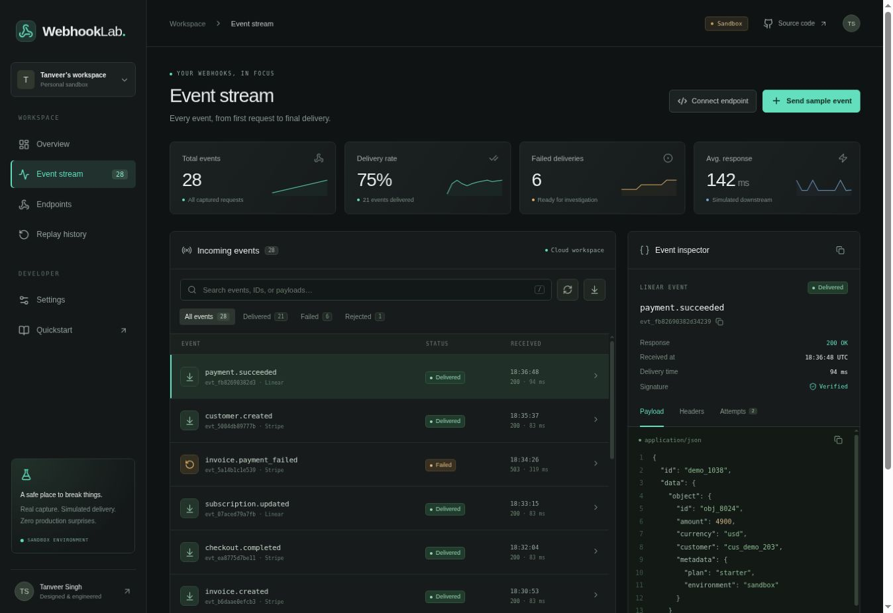

# WebhookLab

[**Open live demo**](https://webhooklab-umber.vercel.app) · [Verification record](docs/verification.md) · [Source & architecture](docs/architecture.md)

**Every event. Understood.** A polished webhook capture, inspection, and recovery workbench by [Tanveer Singh](https://singhtanveer.com).



## What works

- Real authenticated inbound HTTP capture with exact-body HMAC-SHA256 verification.
- Private workspace per browser token, persisted through a server-only cloud database adapter.
- Search event types, IDs, sources, and payloads; combine searches with status filters.
- Inspect formatted JSON, capture metadata, and complete delivery attempt history.
- Send signed sample requests, intentionally fail signature verification, and select delivery outcomes.
- Replay failures with exponential backoff, an explicit simulated clock, and a hard twenty-attempt cap.
- Download retained events as JSON, reset synthetic data, and rotate the workspace signing secret.
- Responsive, keyboard-accessible interface with status text and reduced-motion support.

**Simulation boundary:** inbound capture and HMAC verification are real. Downstream delivery uses a deterministic in-process simulator. No user-provided URL is requested. Seed events are synthetic. The console reports simulator latency, not network measurements. Replay runs only when explicitly requested; no background retry worker is implied. Clock advances affect retry eligibility and simulated attempt timestamps.

## Run locally

```sh
npm ci
npm test
npm run typecheck
npm run build
npm run dev
```

Vite serves the frontend on port 5101. Vercel runs the `/api` routes in production. For API development use `vercel dev` with the server environment configured. A plain Vite session cannot run the API: the connection error offers an **explicit local demo** that lasts only for the current page session. There is no automatic offline persistence or false cloud success.

## Deployment

Deploy the repository to Vercel as a Vite project, with `npm run build` and output directory `dist`. Configure `SUPABASE_URL` and `SUPABASE_PUBLISHABLE_KEY` as server-only environment variables and create the shared workspace persistence table expected by `api/_lib/store.ts`. Keep the database access in server functions; do not prefix environment variables with `VITE_`. The publishable key is constrained by database row-level security and each workspace capability token. See [architecture](docs/architecture.md) for the API contract and operational boundaries.

## Ingest a real webhook

Open **Connect endpoint** in the console and copy its runnable Node.js example. The private workspace token stays in `localStorage` under `webhooklab-token`; the signing secret is unique to that workspace. Requests use:

```http
POST /api/ingest
Authorization: Bearer <64-lowercase-hex-workspace-token>
Content-Type: application/json
X-Webhook-Signature: sha256=<HMAC-SHA256-of-exact-body>
X-Delivery-Scenario: recover
```

`X-Delivery-Scenario` is optional and accepts `success`, `recover`, or `always-fail`. Payloads must be valid JSON and at most 64 KB. A valid signature returns `202`; an invalid or absent signature is retained as a rejected event and returns `401`. Invalid JSON returns `400` without creating an event. Successful capture acknowledges storage, not delivery to a real external service. Refresh the event feed after sending an external request.

## Verification

`npm test` uses Node’s built-in runner with TypeScript loading. The suite checks malformed JSON, altered signature bytes, malformed digests, backoff enforcement, bounded replay attempts, rejected-event protection, and combined filters. Implementation began with observed failing tests.

## Scope

This portfolio MVP retains up to 150 events per workspace within a 450 KB state budget, and 20 attempts per event. Oldest events are evicted first. Workspace tokens rotate in the browser after six days; persisted capabilities expire after seven days. Workspace possession is bearer authorization, not user account authentication. Reset rotates the signing secret but preserves the workspace token. No cross-device account sync, real downstream forwarding, background scheduler, webhook timestamp anti-replay protocol, or production rate limiting is claimed. Treat it as a development sandbox and avoid sending sensitive production data.

## Stack

React 19 · TypeScript · Vite · Node.js Vercel functions · Supabase persistence · native Node crypto · Lucide icons.

Designed and engineered by [Tanveer Singh](https://singhtanveer.com) · [GitHub](https://github.com/tanveerchana)
